# Impact Brands: one trusted data model for 7 brands

From public storefront data to a tested marketing & subscription warehouse (dbt · BigQuery-ready · Looker Studio).
Independent case study built for a *Data Specialist* application. **Not affiliated with or endorsed by Impact Brands.**
Public figures are labelled **PUBLIC DATA**; everything internal (orders, subscriptions, payments, ads) is **SIMULATED** and labelled as such.

**Report (11 pages):** [docs/ImpactBrands_DataCaseStudy.pdf](docs/ImpactBrands_DataCaseStudy.pdf)

| Key result | Data |
|---|---|
| **207 products** across the 7 storefronts, sold through one offer logic: 6 units cost 33% less per unit than 1, and 50% less on subscribe & save. PureHealth Research and Nation Health MD carry 66% of the catalogue and 98% of on-site reviews. | PUBLIC |
| **100% of sales and ad spend mapped to a product** after a fix at the source; before it, 6.1% of Jul-Sep 2026 sales (a new product) and 22.7% of May-Sep spend (a new ad account, campaign typos) had no product. | PUBLIC + SIMULATED |
| **ROAS 2.45 in the ad platforms vs 1.71 on net first-party revenue** (May 2026): 26% of platform value is not backed by a real order; every step of the gap is quantified layer by layer. | SIMULATED |
| **9 of 10 injected data defects caught** by dbt tests before any dashboard showed them; the miss (a campaign name matching the wrong product) is documented with the test to add. | SIMULATED |

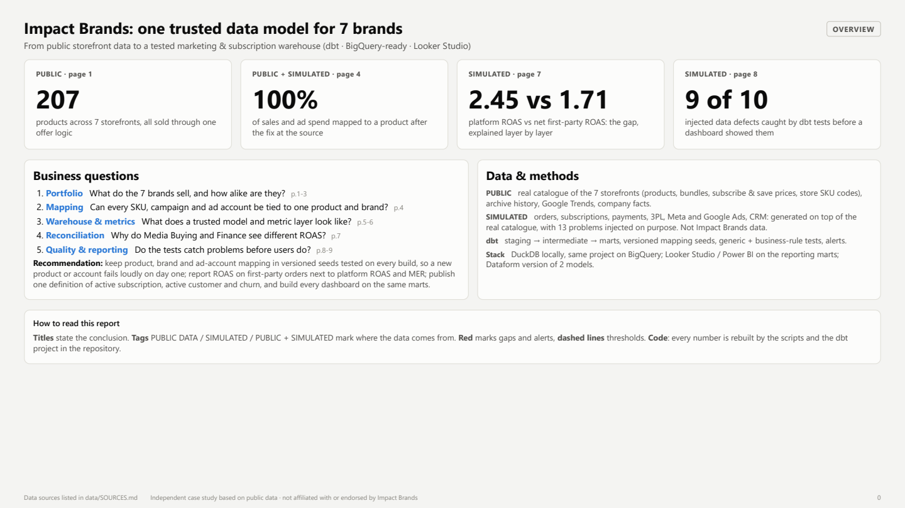

## Questions and answers
| # | Question | Answer |
|---|---|---|
| 1 | What do the 7 brands sell, and how alike are they? | 207 products, same storefront and checkout platform on 6 stores, same bundle ladder (1/3/6 units) and two subscribe & save policies (16.7% for PHR, NHMD, NBL; 10% for PUR, TRU, PET). One product model fits all brands. |
| 2 | Can every SKU, campaign and ad account be tied to one product and brand? | Yes, with versioned seeds: 758 real store codes (3 code styles, a store code `LHP` that is not the brand name, the same product name in two brands) plus 3PL codes map to 207 products; campaigns map through name tokens within the ad account's brand. Tests fail on the first unmapped sale, campaign or account. |
| 3 | What does a trusted model and metric layer look like? | 33 dbt models (staging → intermediate → marts), 84 tests, one written definition per metric. The subscription tool's ACTIVE status overstates active subscriptions by 4.8% (paused and failing ones). |
| 4 | Why do Media Buying and Finance see different ROAS? | Attribution windows (−26% of platform value), time zone (small per month, 4% of Google orders change day), refunds and chargebacks (−5.4%); before the fixes, a missing ad account and a duplicate connector load also moved spend. |
| 5 | Do the tests catch problems before users do? | 9 of 10 injected defects caught (measured against a hidden answer key on a replay without the fixes); 3 structural differences are explained in the reconciliation bridge rather than alerted. |

## Pages
| | |
|---|---|
| 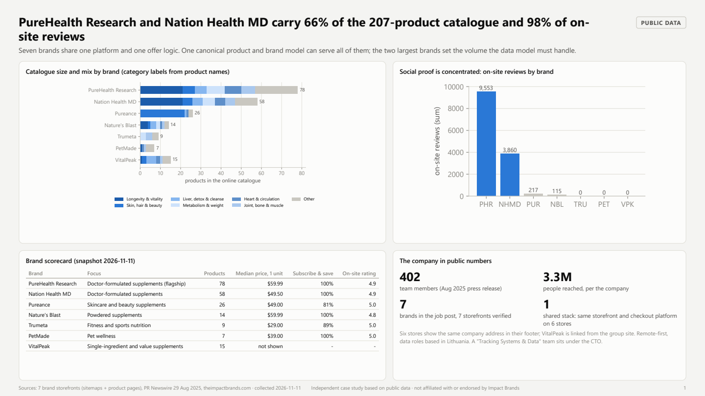 | 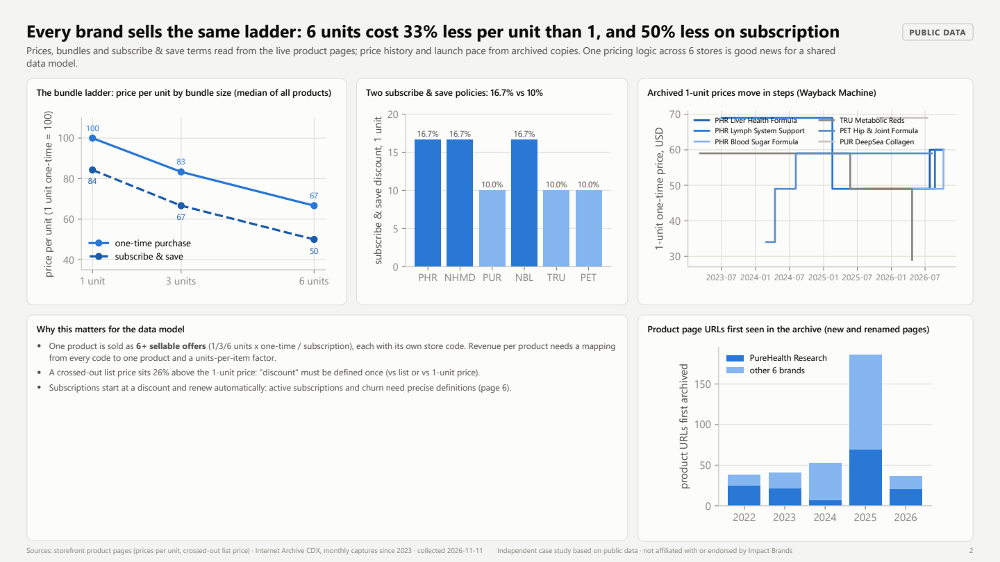 |
| 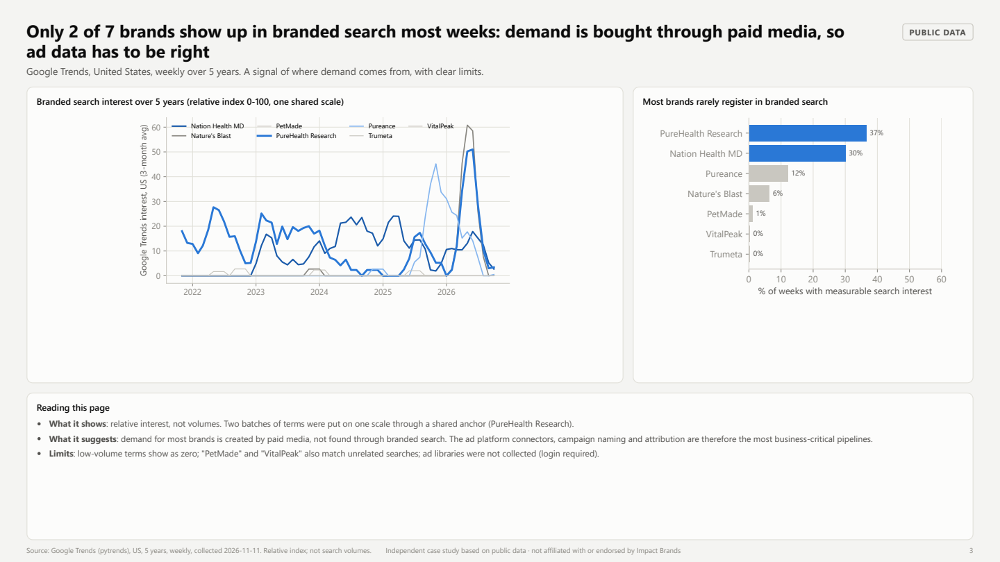 | 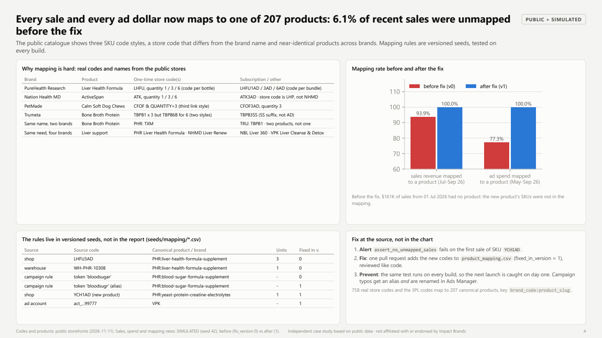 |
| 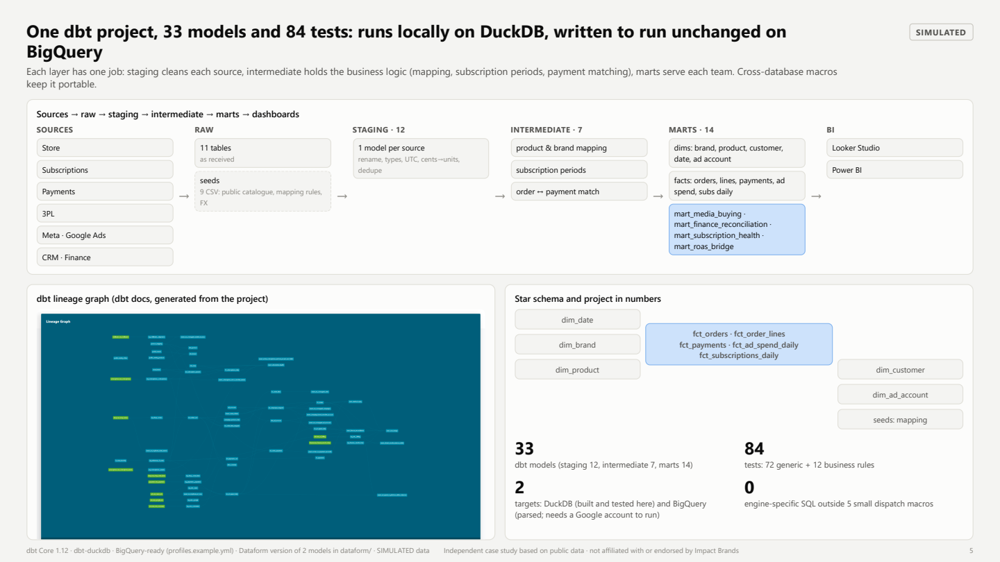 | 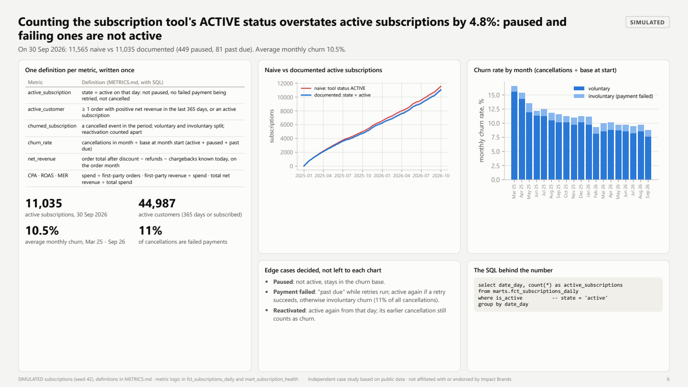 |
| 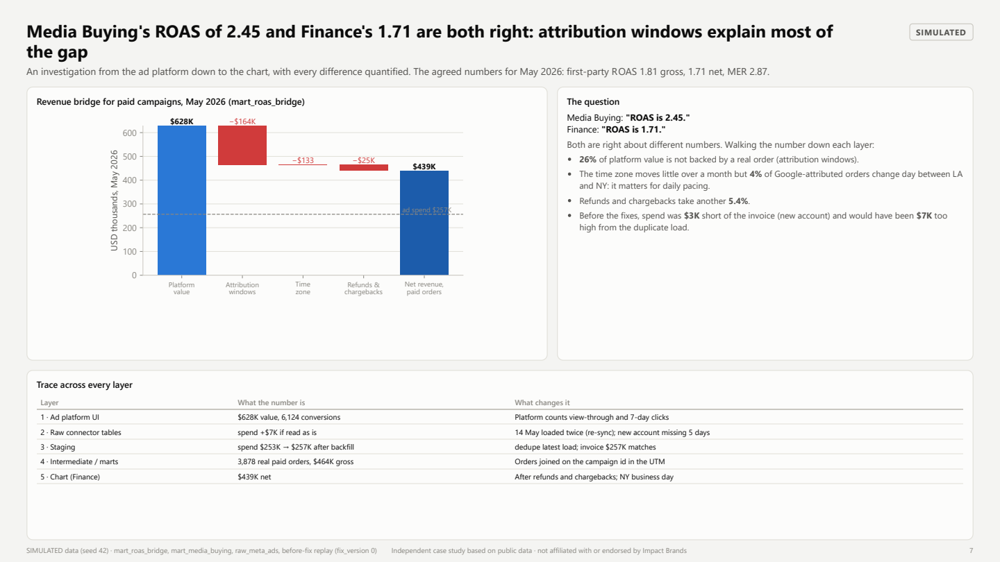 | 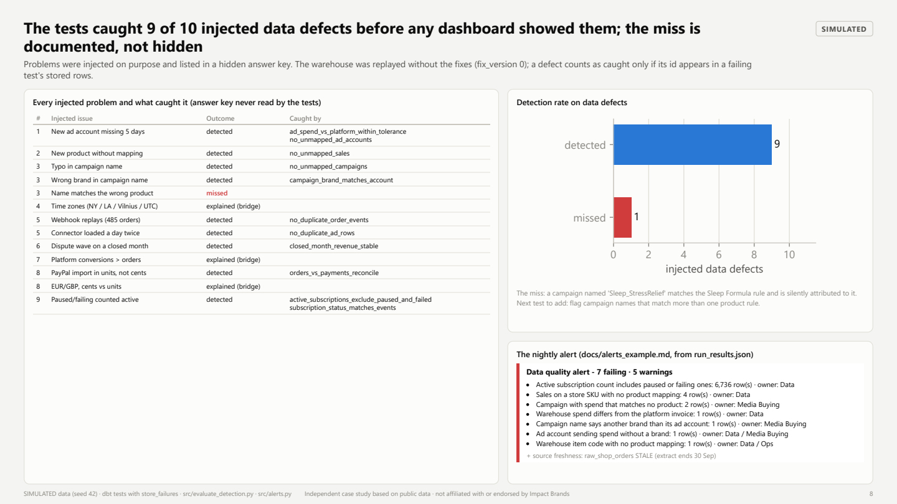 |
| 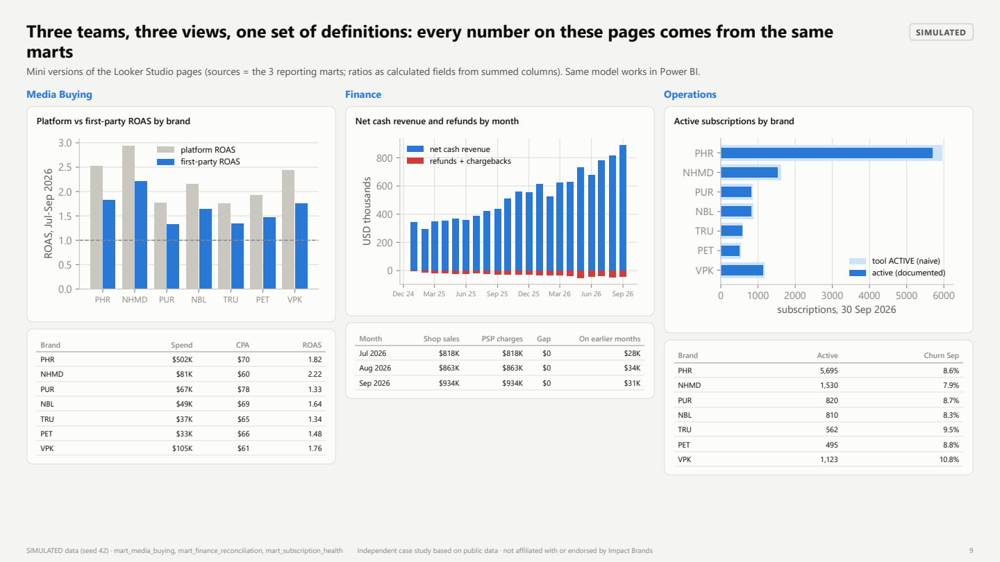 | 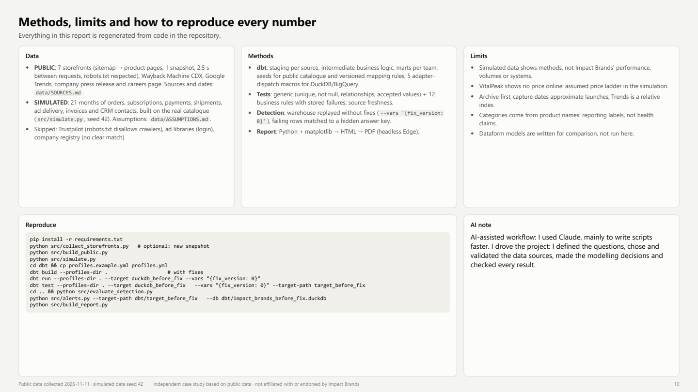 |

## Architecture
```
data/raw/            public snapshots: storefronts/<brand>/<date>.json, wayback/, trends/
data/public/         clean public tables (catalogue, offers, price history, trends)
data/simulated/      SIMULATED raw tables (Parquet) + hidden answer key of injected issues
src/                 collect_*.py, build_public.py, simulate.py, alerts.py, evaluate_detection.py,
                     build_report.py, load_bigquery.py
dbt/                 dbt project (DuckDB locally, BigQuery target in profiles.example.yml)
  models/staging/        1 model per source: rename, types, UTC, cents→units, dedupe
  models/intermediate/   campaign & product mapping, subscription periods, order↔payment match
  models/marts/core/     dim_brand, dim_product, dim_customer, dim_date, dim_ad_account,
                         fct_orders, fct_order_lines, fct_payments, fct_ad_spend_daily, fct_subscriptions_daily
  models/marts/reporting/ mart_media_buying, mart_finance_reconciliation, mart_subscription_health, mart_roas_bridge
  seeds/public/          the real catalogue
  seeds/mapping/         versioned mapping rules (product_mapping, campaign_product_rules, ad_accounts, ...)
  tests/                 12 business-rule tests (stored failures)
  macros/                5 cross-database dispatch macros (DuckDB / BigQuery)
dataform/            the same 2 models in Dataform SQLX
docs/                report PDF + HTML, page images, alerts_example.md
```

**Fix at the source, replay before the fix.** Mapping rows added after an alert carry `fixed_in_version = 1`.
`dbt build --vars '{fix_version: 0}'` replays the warehouse as it was before the fixes; that run is used to measure how many injected issues the tests catch.

**Tests.** Generic tests (unique, not null, relationships, accepted values, unique combinations) and 12 business rules:
`assert_no_unmapped_sales`, `assert_no_unmapped_warehouse_skus`, `assert_no_unmapped_ad_accounts`, `assert_no_unmapped_campaigns`,
`assert_campaign_brand_matches_account`, `assert_ad_spend_vs_platform_within_tolerance`, `assert_orders_vs_payments_reconcile`,
`assert_no_duplicate_order_events`, `assert_no_duplicate_ad_rows`, `assert_closed_month_revenue_stable`,
`assert_active_subscriptions_exclude_paused_and_failed`, `assert_subscription_status_matches_events`; plus source freshness.
Errors block; warnings are monitors on source problems already handled in staging. `src/alerts.py` turns `run_results.json`
into a Slack-style message: [docs/alerts_example.md](docs/alerts_example.md).

## How to run
```bash
python -m venv .venv
.venv/Scripts/pip install -r requirements.txt        # (.venv/bin/pip on macOS/Linux)
python src/build_public.py                            # public snapshot -> data/public + dbt seeds
python src/simulate.py                                # SIMULATED raw data (seed 42)
cd dbt
cp profiles.example.yml profiles.yml
dbt build --profiles-dir .                            # 33 models + 84 tests, 0 errors, 5 monitor warnings
dbt source freshness --profiles-dir .                 # the simulated extract ends on 30 Sep 2026: flagged stale
```
Before-fix replay, detection rate, alert and report:
```bash
dbt seed --profiles-dir . --target duckdb_before_fix
dbt run  --profiles-dir . --target duckdb_before_fix --vars "{fix_version: 0}"
dbt test --profiles-dir . --target duckdb_before_fix --vars "{fix_version: 0}" --target-path target_before_fix
cd ..
python src/evaluate_detection.py
python src/alerts.py --target-path dbt/target_before_fix --db dbt/impact_brands_before_fix.duckdb
python src/build_report.py                            # needs Edge or Chrome for the PDF
```
New public snapshot (optional, ~10 minutes, polite rate): `python src/collect_storefronts.py`, `collect_wayback.py`, `collect_trends.py`.

**BigQuery-ready: the same project runs on dbt-bigquery.** Load the raw tables with `python src/load_bigquery.py`, then
`dbt build --profiles-dir . --target bigquery`. All engine-specific SQL sits in 5 dispatch macros (`macros/cross_db.sql`);
the rest uses dbt's cross-database macros. The project parses on dbt-bigquery; it has not been run on a BigQuery project yet
(that needs a Google account), so the local DuckDB build is the tested path.

**Looker Studio.** The three reporting marts are the data sources (one page each: Media Buying, Finance, Operations);
ratios are calculated fields from summed columns, e.g. `SUM(first_party_gross_revenue_usd) / SUM(spend_usd)`.

## dbt ↔ Dataform
| Concept | dbt | Dataform |
|---|---|---|
| Model | `.sql` + `.yml` | `.sqlx` (config block + SQL) |
| Reference | `{{ ref('model') }}`, `{{ source('shop', 'raw_shop_orders') }}` | `${ref("model")}`, `declaration` |
| Materialization | `materialized='table'` | `type: "table"` |
| Incremental | `is_incremental()` | `when(incremental(), ...)` |
| Tests | `data_tests`, singular tests in `tests/` | `assertions: { uniqueKey, nonNull, rowConditions }` |
| Variables | `var('fix_version')` | `dataform.projectConfig.vars.fixVersion` |

Two models rewritten in Dataform: [dataform/](dataform/).

## Metric definitions
Full definitions with SQL and edge cases: [METRICS.md](METRICS.md).
- **active_subscription**: state active that day (not paused, no failed payment being retried, not cancelled).
- **active_customer**: an order with positive net revenue in the last 365 days, or an active subscription.
- **churned_subscription / churn_rate**: cancellations in the month ÷ base at the start of the month (active + paused + past due); voluntary and involuntary split.
- **net_revenue**: order total after discount − refunds − chargebacks known today, on the order month.
- **CPA / ROAS / MER**: spend ÷ first-party orders · first-party revenue ÷ spend · total net revenue ÷ total spend.

## Public data sources
Details, dates and limits: [data/SOURCES.md](data/SOURCES.md). Snapshot of 2026-11-11.
- The 7 storefronts (purehealthresearch.com, nationhealthmd.com, pureance.com, trumeta.com, petmade.com, naturesblaststore.com, thevitalpeak.com): sitemap → product pages, robots.txt respected, 2.5 s between requests.
- Internet Archive Wayback Machine (CDX API): first archive capture of product URLs, monthly price history of 8 products.
- Google Trends (US, 5 years).
- Company press release (PR Newswire, Aug 2025) and the group's careers site.
- Skipped: Trustpilot (robots.txt disallows crawlers), ad libraries (login), company registry (no clear match).

## Limits
- Simulated data shows methods, not Impact Brands' performance, volumes or systems. Assumptions: [data/ASSUMPTIONS.md](data/ASSUMPTIONS.md).
- VitalPeak shows no price online: the simulation uses an assumed price ladder for it.
- Archive first-capture dates approximate launches; Google Trends is a relative index.
- Categories are reporting labels derived from product names, not health claims.
- Dataform models and the BigQuery target are written but not run here.

## Methods
Python (requests, pandas) for collection and simulation; dbt Core on DuckDB for the warehouse; matplotlib → HTML → PDF (headless Edge) for the report.

AI-assisted workflow: I used Claude, mainly to write scripts faster. I drove the project: I defined the questions, chose and validated the data sources, made the modelling decisions and checked every result.
